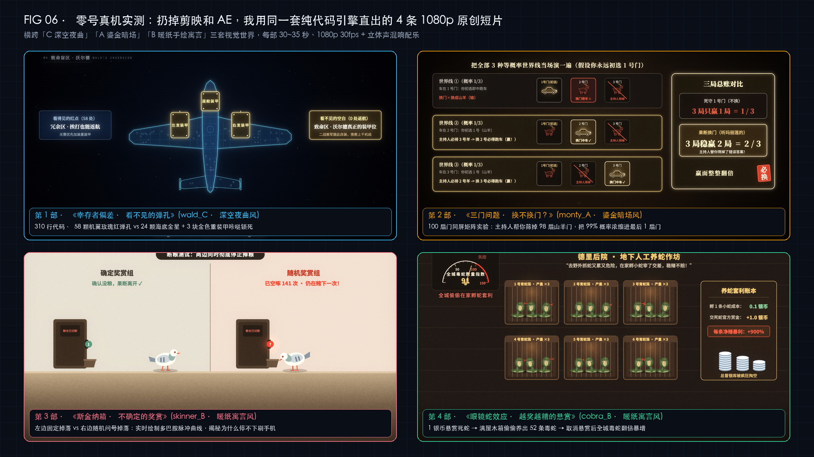
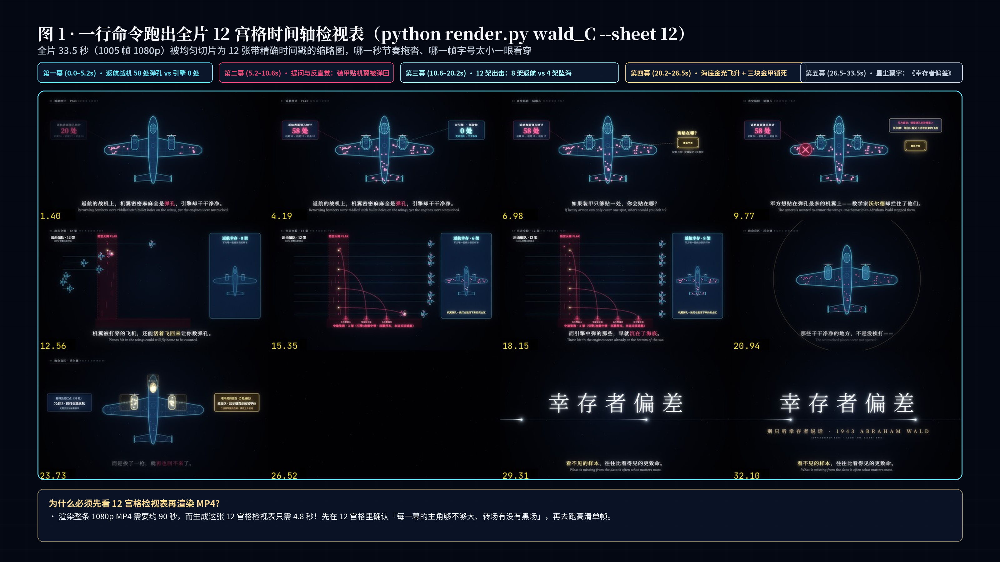
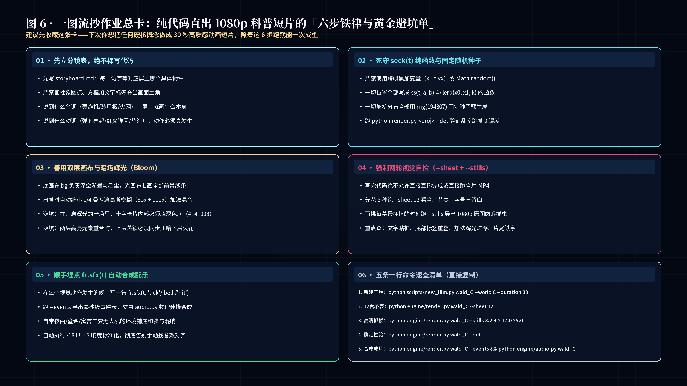

# Claude Fable 5.2 纯代码视频与交互动画开源百宝箱（209 案例索引 + 260 原始 Prompt + 4 部 1080p 原创短片源码）

> 微信公众号 **「零号白泽 (`AgentBaiZe`)」** 文章《我扒完了Claude Fable 5.2刷屏的209个源码和Prompt，今天向所有人免费开源。》配套开源仓库。



---

## 📦 仓库三大核心模块速览

| 目录 | 包含内容 | 直接用途 |
| :--- | :--- | :--- |
| **[`01_209_Cases_Directory/`](01_209_Cases_Directory/)** | 全网爆火的 **209 个 Claude Fable 5.2 纯代码视频 / 3D 交互游戏核验总表** + 15 大标杆工程官方仓库与在线试玩直达索引 | 一键直达 `Saltline`、`Oil Paint`（150万笔触森林）、`Evensong`、`Pelican on a Bicycle` 等全部原帖与开源仓 |
| **[`02_260_Original_Prompts/`](02_260_Original_Prompts/)** | **[《PROMPTS_全量原始提示词与生成指令总汇.md》](02_260_Original_Prompts/PROMPTS_全量原始提示词与生成指令总汇.md)** + **180 份独立视频生成 Prompt 档案** + **Saltline 4 步无人值守复现 System Prompt** | 直接复制喂给 Claude Code / Cursor，复现「一句话极简放权流」或「导演分镜防穿模契约流」 |
| **[`03_4_Original_1080p_Films/`](03_4_Original_1080p_Films/)** | 零号手搓的 **4 部 1080p 30fps 原创知识短片完整源码**（`wald_C` 幸存者偏差、`monty_A` 三门问题、`skinner_B` 斯金纳箱、`cobra_B` 眼镜蛇效应）+ MIT `seek(t)` 渲染与物理建模合成配乐引擎 | 不用剪映和 AE，在本地用几百行 JS + Python 直接渲染出带毫秒级同步配乐的 1080p MP4 成片 |

> 🎬 **4 部 1080p 有声成片 MP4 在线观看 / 下载**：请直接前往本仓库右侧 **[Releases (`v1.0.0`)](../../releases)** 下载或预览 4 条渲染好的 `1080p` 原片！

---

## 🚀 3 分钟本地跑通 1080p 纯代码短片渲染



```bash
cd 03_4_Original_1080p_Films

# 1. 安装 Python 依赖并拉取 SIL OFL 开源字体
pip install -r requirements.txt playwright
playwright install chromium
python3 engine/get_fonts.py

# 2. 生成《幸存者偏差 · 看不见的弹孔》12 宫格全片时间轴检视表（5 秒出图）
python3 engine/render.py films/wald_C --sheet 12

# 3. 本地浏览器实时预览（支持拖动进度条任意定格 seek(t)）
python3 engine/render.py films/wald_C --serve

# 4. 多进程并行直出 1080p 30fps 带物理合成配乐的成品 MP4
python3 engine/render.py films/wald_C --jobs 6
```

### 内置 4 部原创短片工程一览

1. **`films/wald_C` —— 《幸存者偏差 · 看不见的弹孔》**（夜曲深空双层高斯辉光风 · 310 行 JS + 40 处合成音效）
2. **`films/monty_A` —— 《三门问题 · 换不换门？》**（鎏金暗场风 · 100 扇门矩阵直观浓缩 99% 概率）
3. **`films/skinner_B` —— 《斯金纳箱 · 不确定的奖赏》**（暖纸手绘寓言风 · 双鸽对照 + 实时多巴胺脉冲曲线）
4. **`films/cobra_B` —— 《眼镜蛇效应 · 越奖越糟的悬赏》**（暖纸手绘寓言风 · 激励扭曲与套利繁殖推演）

---

## 🛡️ 纯代码直出 1080p 短片的六步自检铁律



---

## 📄 开源许可与致谢（License & Credits）

- 本仓库内 `03_4_Original_1080p_Films/` 原创短片源码采用 **MIT License** 开源，底层渲染引擎基于开源项目 `vibe-knowledge-film`（MIT）。
- `02_260_Original_Prompts/180_video_prompts/` 整理自社区开源索引 `yihui-dev/awesome-fable5-2-videos`（MIT），各标杆案例的原始作品版权归各自原作者所有（详见 `01_209_Cases_Directory/` 内原帖与官方仓库链接）。
- 欢迎关注微信公众号 **「零号白泽」**（微信号：`AgentBaiZe`），第一时间看全球大模型硬核实测与开源拆解。
